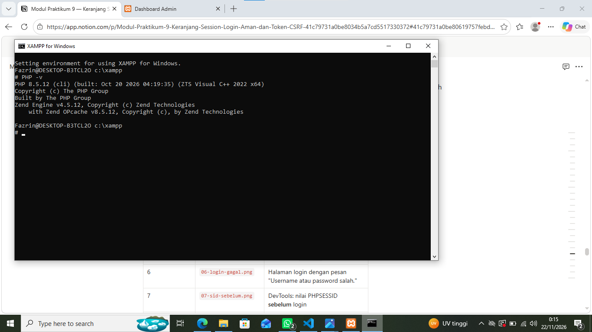
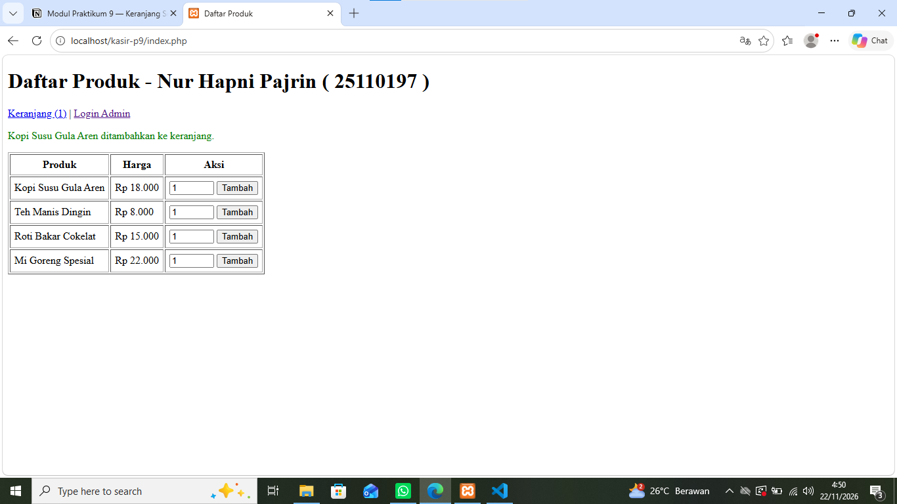
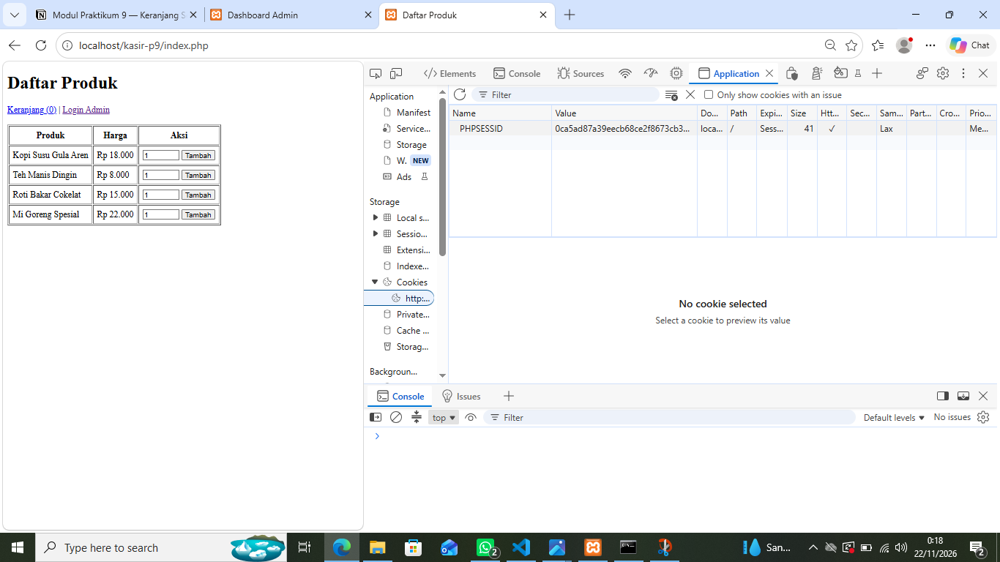
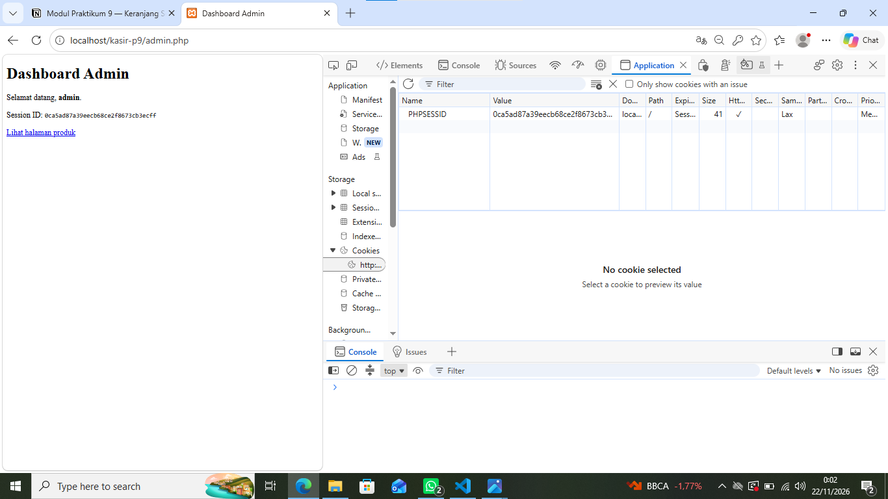
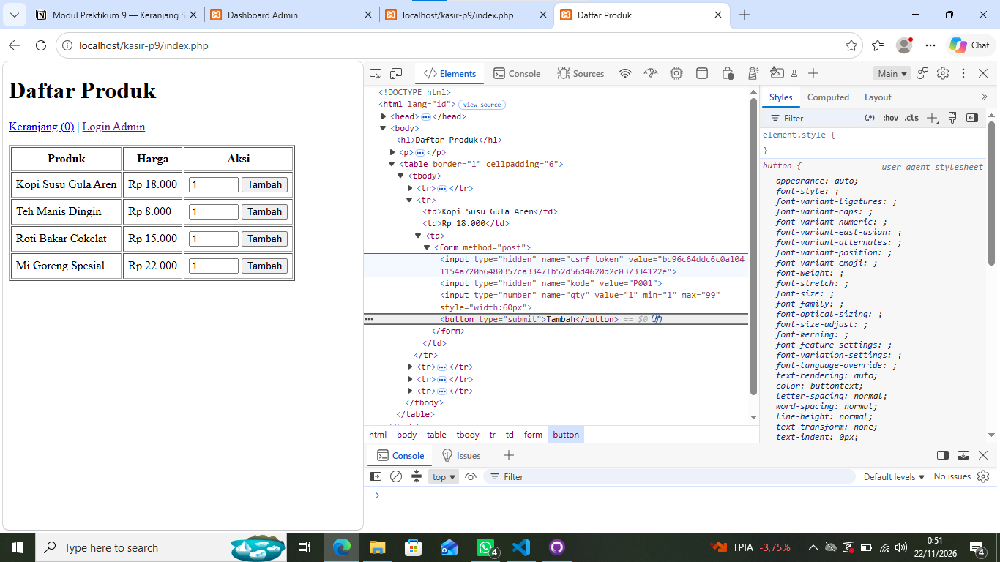
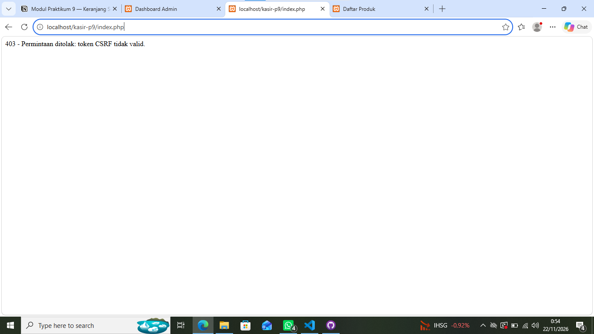
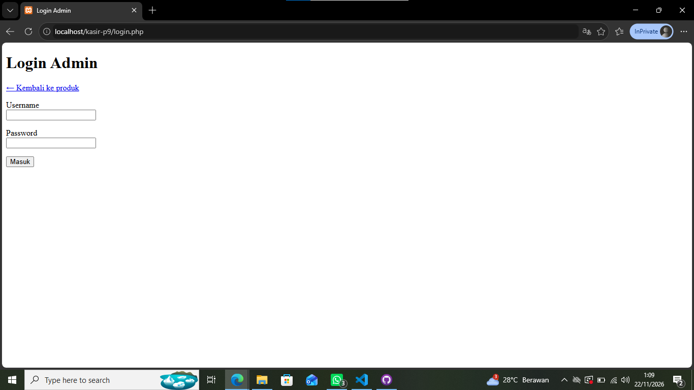

# Laporan Praktikum 9 — Keranjang Session, Login Aman, dan Token CSRF

Nama : Nur Hapni Pajrin
NIM  : 25110197
Kelas: TK Grup D
Versi PHP: 8.5.12

## 1. Lingkungan

## 2. Keranjang berbasis session

## 3. Login dengan password hash

## 4. Token CSRF

## 5. Hasil uji fungsional
| No | Uji | Hasil (Lulus/Gagal) |
|----|-----|---------------------|
| 1 | Keranjang bertahan |Lulus|
| 2 | Password tersimpan sebagai hash |Lulus |
| 3 | Regenerasi session | |
| 4 | Tolak request tanpa token |Lulus |
| 5 | Pesan login umum |Lulus |
| 6 | Halaman terproteksi |Lulus|

## 6. Pertanyaan
1. Mengapa isi keranjang tidak terlihat di cookie browser?
   Jawab: Karena keranjang disimpan di dalam $_SESSION di server, bukan di cookie. Cookie hanya menyimpan session_id saja sebagai kunci, sedangkan isi keranjangnya tetap aman di server.
2. Apa yang terjadi jika baris session_regenerate_id(true) dihapus?
   Jawab: Session ID tidak berubah setelah login, jadi rentan kena session fixation. Orang lain yang sudah tahu session_id lama bisa memakai session itu untuk masuk sebagai kita setelah kita login.
3. Mengapa tombol Hapus dibuat dengan form POST, bukan link?
   Jawab: Karena Hapus itu mengubah data. Kalau pakai link (GET) bisa kehapus tidak sengaja, misalnya saat orang klik link dari website lain atau saat search engine meng-crawl. Kalau pakai POST + token CSRF, request hapus jadi lebih aman.